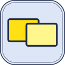
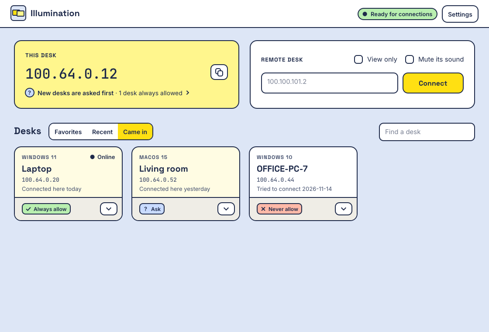
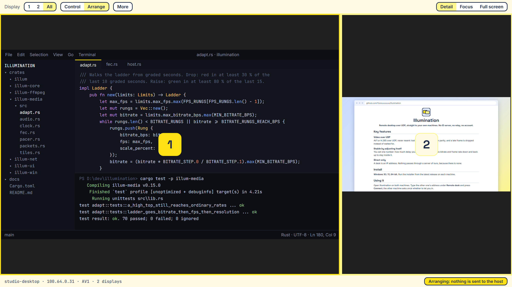

  

<h1 align="center">Illumination</h1>

<b>Remote desktop over UDP, straight to your own machines. No ID server, no relay, no account.</b>

  

Illumination is what AnyDesk and RustDesk do, with the picture sent the way game streaming
sends it. You type another machine's IP address, for example its
[Tailscale](https://tailscale.com) address, and use its screen, keyboard, mouse, sound and
clipboard.

  
   
  <em>One window, every display of the other desk.</em>

---

## Key features

### Video over UDP
AnyDesk and RustDesk send the picture over a reliable connection, so one lost packet holds
back everything behind it. Illumination sends AV1 or H.265 over UDP and never resends: lost
packets are rebuilt from parity, and a late frame is dropped instead of waited for.

### Stable by adjusting itself
You set one number: how much delay you accept. The host watches how late frames arrive and
moves bitrate and frame rate down and back up to stay inside it, and tells a congested link
from one that merely loses packets.

### Direct only
A desk is an IP address. Nothing passes through a server of ours, because there is none.

The technical documents are in [`docs/`](docs/README.md).

---

## Install

**Windows 10 / 11, 64-bit.** Run the installer from the
[latest release](https://github.com/Yooouuuuuuu/illumination/releases/latest) on each
machine. It isn't code-signed yet: on the SmartScreen warning, click **More info → Run
anyway**.

## Using it

Open Illumination on both machines. Type the other one's address under **Remote desk** and
press **Connect**; the other machine asks once whether to let you in.

---

## Acknowledgements

- **Sunshine / Moonlight:** low-latency capture, encoding and streaming
- **AnyDesk:** the reference for behaviour
- **RustDesk:** lessons and UX ideas

None of their code is included.

## License

GPL-3.0-only. See [LICENSE](LICENSE).
